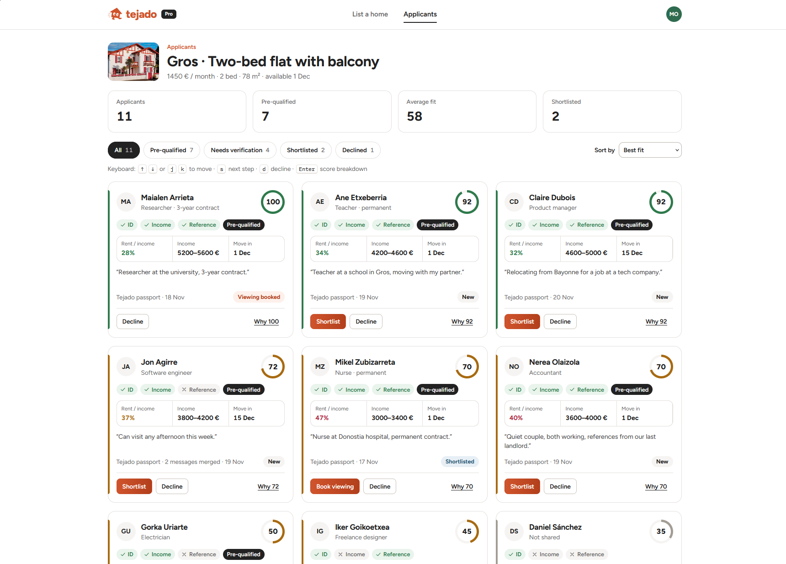

# Tejado

**Renting in Spain, without the queue.** Tejado is a rental platform built around Spain's 2023 Housing Law. Tenants verify themselves once and apply to any home in one tap. Agents get applicants who are already checked and ranked, and every listing is checked against the rules before it goes live.

## The business case

### The market

- **idealista leads Spanish property search, and it's very profitable.** In 2025 it reported €346M in revenue and €160M in EBITDA, a margin of about 46%. The private equity firm Cinven paid €2.9B for a 70% stake in December 2024. [¹](#sources)
- **The market is consolidating.** The number two, Fotocasa, was sold with Habitaclia to Scout24 for about €153M in 2025. [²](#sources)
- **The moat is listings, not product.** Agencies pay idealista per listing for subscriptions and premium visibility, whether or not anything rents. Tenants go wherever the listings are, so the product has had little reason to improve. [³](#sources)

### What's broken

1. **Renting is a bottleneck on both sides.** In Q2 2025 a rental listing got about 38 enquiries on average before coming down. Tenants hear nothing back, and agents sort messages by hand. [⁴](#sources)
2. **The law changed what renting earns, but the tools stayed the same.** Since Ley 12/2023, the landlord pays the agency fee on rentals and rents are capped in stressed zones. Since July 2025, seasonal lets need an NRUA registration number, which platforms must check. A third of agencies now say they no longer take on rentals. [⁵](#sources)
3. **Duplicate listings and low trust.** Few agencies hold exclusive mandates, so the same flat shows up several times. Unions have accused the big portals of carrying flats without habitability certificates and of tolerating "pre-reservation" fees. [⁶](#sources)
4. **People only visit while they're moving.** Nothing brings tenants back between moves, so the portals have to buy that demand again every time.

### Tejado vs idealista

| | idealista | Tejado |
| --- | --- | --- |
| **What agents pay for** | Listing subscriptions and premium visibility | A fee per signed rental or managed unit, paid only when it works |
| **Enquiries** | Unsorted messages from many channels | Ranked by fit, with duplicates merged. Unverified contacts are asked to verify |
| **Tenant screening** | Left to the agent, over email and WhatsApp | A reusable tenant passport: identity, income band and references, shared with consent |
| **Compliance** | The agent's responsibility | Every listing is checked before publishing (fee, deposit, guarantee, rent cap, NRUA, habitability certificate). Blocked listings never reach any portal |
| **Duplicate listings** | One card per agency | One card per home. The application goes to the agency with the mandate |
| **Tenant updates** | Little or nothing after the first message | A visible status: seen, shortlisted, viewing, offer, contract |
| **Contract and deposit** | Handled outside the portal | Lease, deposit and the landlord's fee invoice in one step |
| **Relationship with portals** | — | Also publishes to idealista and Fotocasa, so agents can switch without losing reach |

### Why it can win

- **It starts with the agents' daily work, not with listings.** Agents adopt a tool that saves time on every rental and keeps them on the portals they already use. Listings follow the tool, the same way idealista's own agency software feeds idealista.
- **The passport creates a network effect.** Agents prefer verified applicants, so they ask tenants to verify. Each verified tenant makes every listing faster to fill.
- **Compliance is a selling point, not a cost.** The rules keep tightening, so being the safest place to publish matters more every year.
- **There's room for a challenger.** The competition regulator, the CNMC, fined idealista over a shared-listing system that limited agents' freedom to set their own commissions. It also stepped in on idealista's planned purchase of Kyero, which was then cancelled. [⁷](#sources)
- **It launches city by city.** Start where rental pressure is highest, such as Donostia, Bilbao, Valencia or Málaga. Sign up the local property managers, then advertise to tenants there.

### Roadmap

1. **Pro tool for agents and property managers.** Enquiries ranked by fit, rule checks on every listing, contracts and fee invoices, and publishing to the portals. *This repo covers this phase: the listing wizard and the applicant cards.*
2. **Tenant passport and search.** Tenants verify once and apply to any home in one tap, see one card per home, and track every application.
3. **Staying useful between moves.** Rent payments, rent updates in line with the official index, repairs, renewals and owner valuations, so people keep coming back when they aren't moving.

<a id="sources"></a>
<sub>**Sources:** ¹ [idealista FY25 results](https://www.onlinemarketplaces.com/articles/idealista-fy25-revenues-up-15-as-ebitda-doubles/) · ² [Spanish portal consolidation](https://www.spanishpropertyinsight.com/2025/09/19/spanish-property-portal-sector-shaken-up-as-consolidation-gathers-pace) · ³ [Fotocasa's GM on competing with idealista](https://www.onlinemarketplaces.com/articles/fotocasa-gm-tony-blamey-on-competing-with-idealista-and-finding-a-path-to-growth/) · ⁴ [Contacts per listing](https://www.merca2.es/2025/07/23/vivienda-idealista-fotocasa-2216459/) · ⁵ [Who pays agency fees](https://www.reclamador.es/blog/?p=30955), [NRUA registry](https://www.cronista.com/espana/actualidad-es/adios-ley-de-alquileres-el-gobierno-prohibira-a-los-propietarios-ofrecer-sus-viviendas-para-el-turismo-si-no-completan-este-tramite), [agencies leaving rentals](https://www.elespanol.com/invertia/observatorios/vivienda/20260201/crisis-alquiler-empeora-tercio-inmobiliarias-no-capta-pisos-perder-viviendas-anos/1003744110396_0.html) · ⁶ [UGT complaint](https://www.onlinemarketplaces.com/articles/rampant-substandard-housing-as-trade-union-denounces-idealista-and-fotocasa/) · ⁷ [CNMC fine](https://www.cnmc.es/sites/default/files/editor_contenidos/Notas%20de%20prensa/2021/20211209_NP_Sancionador_Proptech_eng.pdf), [Kyero deal cancelled](https://www.onlinemarketplaces.com/articles/idealistas-kyero-acquisition-cancelled-as-competition-authority-steps-in/)</sub>

---

## The prototype: listing wizard and applicant cards

A small React + TypeScript app built from the Tejado rental prototype. Tejado helps letting agents in Spain publish rentals that follow the 2023 Housing Law and pick the right tenant faster.

| List a home | Applicants |
| --- | --- |
|  |  |

It has two parts:

- **List a home**: a four-step setup wizard (Property → Rent & terms → Documents → Review & publish). A rule check panel updates as you type and blocks publishing while any rule fails.
- **Applicants**: a grid of candidate cards built to be scanned. Every card has the same layout, so an agent can compare a dozen people at a glance: name and fit score, then three checks, then three numbers, then their message, then the next action.

## Run it

```bash
npm install
npm run dev        # local dev server
npm test           # 21 unit tests (Vitest)
npm run build      # typecheck + production build into dist/
```

## Decisions worth knowing

**The domain logic lives apart from React.** `src/domain/` holds plain TypeScript: the types, `checkCompliance()`, `fitScore()` and the sample data. It has no React imports and is fully unit tested. Components only display results, so the rules could move to a server without changing the UI.

**Wizard state is a reducer.** `wizardState.ts` holds the step rules: a step can't advance while it's invalid, completed steps stay clickable, you can't skip ahead, and changing the town resets its stressed-zone status. Because it's a pure reducer, it's tested without rendering anything. The draft is saved to `localStorage`, so a reload doesn't lose work.

**Built for scanning.** On each card the fit score is a ring colour-coded strong / possible / weak, with a matching stripe down the card's edge. Checks are green pills or grey crossed-out pills. Rent-to-income is coloured against the 35% that agents usually look for. Messages are clamped to two lines so every row lines up. "Why 92" expands the score into its five parts, so the number is never a black box.

**Keyboard and screen readers.**
- The grid uses a roving tabindex: <kbd>↑</kbd> <kbd>↓</kbd> or <kbd>j</kbd> <kbd>k</kbd> move between cards, <kbd>s</kbd> moves an applicant to the next stage, <kbd>d</kbd> declines, and <kbd>Enter</kbd> opens the score breakdown.
- When a card leaves the current filter, focus moves to the next card, so keyboard users never get dropped back to the top of the page.
- Status changes are announced in an `aria-live` region.
- In the wizard, focus moves to each step's heading, and errors are wired to their fields with `aria-describedby`.

**Privacy by design.** Agents see an income *band* and the result of each check, never the documents behind them.

## Structure

```
src/
  domain/          types, rule checks, fit score, formatting, sample data (+ tests)
  components/
    ListingWizard.tsx    the four steps, live rule check and move-in costs
    wizardState.ts       reducer, validation, draft persistence (+ tests)
    CandidateBoard.tsx   filters, sort, stats, keyboard navigation
    CandidateCard.tsx    one scannable applicant
    CompliancePanel.tsx  rule check list
    ui.tsx               Field, Icon, VerdictPill
  App.tsx, main.tsx, styles.css
```

## Caveats

- **The rules are simplified prototype logic with sample stressed-zone data. They are not legal advice.** The checks cover: the agency fee is paid by the landlord (LAU art. 20.1), the deposit (art. 36.1), the extra guarantee (art. 36.5), the stressed-zone rent caps (Ley 12/2023), the NRUA registration number for seasonal lets (RD 1312/2024), and the habitability certificate.
- **Photos aren't included in the repository.** Add your own or licensed JPGs to `public/img/` using the names in `src/domain/data.ts` (`PHOTOS`), for example `h13.jpg`. Until then, the app shows a neutral house placeholder.
