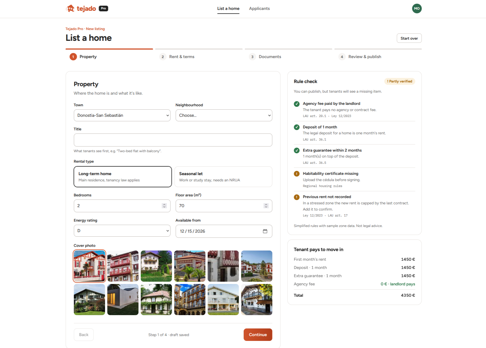

# Tejado Pro: listing wizard and applicant cards

A small React + TypeScript app built from the Tejado rental prototype. Tejado helps letting agents in Spain publish rentals that follow the 2023 Housing Law and pick the right tenant faster.

| List a home | Applicants |
| --- | --- |
|  |  |

It has two parts:

- **List a home**: a four-step setup wizard (Property → Rent & terms → Documents → Review & publish). A rule check panel updates as you type and blocks publishing while any rule fails.
- **Applicants**: a grid of candidate cards built to be scanned. Every card has the same layout, so an agent can compare a dozen people at a glance: name and fit score, then three checks, then three numbers, then their message, then the next action.

## Run it

```bash
npm install
npm run dev        # local dev server
npm test           # 21 unit tests (Vitest)
npm run build      # typecheck + production build into dist/
```

## Decisions worth knowing

**The domain logic lives apart from React.** `src/domain/` holds plain TypeScript: the types, `checkCompliance()`, `fitScore()` and the sample data. It has no React imports and is fully unit tested. Components only display results, so the rules could move to a server without changing the UI.

**Wizard state is a reducer.** `wizardState.ts` holds the step rules: a step can't advance while it's invalid, completed steps stay clickable, you can't skip ahead, and changing the town resets its stressed-zone status. Because it's a pure reducer, it's tested without rendering anything. The draft is saved to `localStorage`, so a reload doesn't lose work.

**Built for scanning.** On each card the fit score is a ring colour-coded strong / possible / weak, with a matching stripe down the card's edge. Checks are green pills or grey crossed-out pills. Rent-to-income is coloured against the 35% that agents usually look for. Messages are clamped to two lines so every row lines up. "Why 92" expands the score into its five parts, so the number is never a black box.

**Keyboard and screen readers.**
- The grid uses a roving tabindex: <kbd>↑</kbd> <kbd>↓</kbd> or <kbd>j</kbd> <kbd>k</kbd> move between cards, <kbd>s</kbd> moves an applicant to the next stage, <kbd>d</kbd> declines, and <kbd>Enter</kbd> opens the score breakdown.
- When a card leaves the current filter, focus moves to the next card, so keyboard users never get dropped back to the top of the page.
- Status changes are announced in an `aria-live` region.
- In the wizard, focus moves to each step's heading, and errors are wired to their fields with `aria-describedby`.

**Privacy by design.** Agents see an income *band* and the result of each check, never the documents behind them.

## Structure

```
src/
  domain/          types, rule checks, fit score, formatting, sample data (+ tests)
  components/
    ListingWizard.tsx    the four steps, live rule check and move-in costs
    wizardState.ts       reducer, validation, draft persistence (+ tests)
    CandidateBoard.tsx   filters, sort, stats, keyboard navigation
    CandidateCard.tsx    one scannable applicant
    CompliancePanel.tsx  rule check list
    ui.tsx               Field, Icon, VerdictPill
  App.tsx, main.tsx, styles.css
```

## Caveats

- **The rules are simplified prototype logic with sample stressed-zone data. They are not legal advice.** The checks cover: the agency fee is paid by the landlord (LAU art. 20.1), the deposit (art. 36.1), the extra guarantee (art. 36.5), the stressed-zone rent caps (Ley 12/2023), the NRUA registration number for seasonal lets (RD 1312/2024), and the habitability certificate.
- **Photos aren't included in the repository.** Add your own or licensed JPGs to `public/img/` using the names in `src/domain/data.ts` (`PHOTOS`), for example `h13.jpg`. Until then, the app shows a neutral house placeholder.
